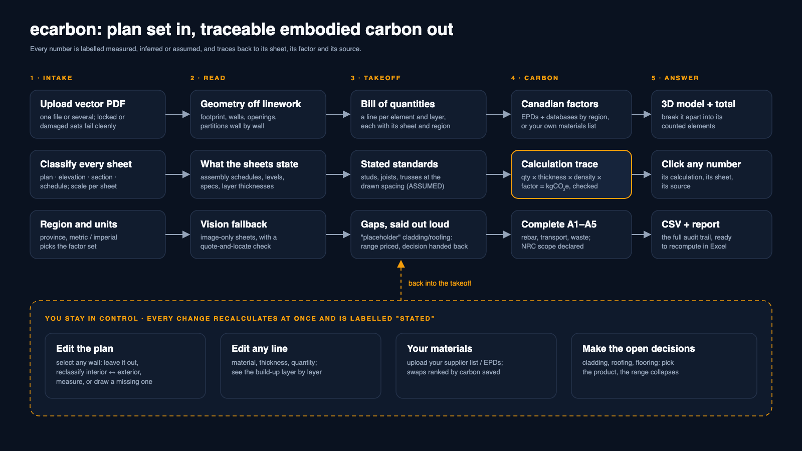

# Embodied Carbon — automated takeoff-to-carbon for residential plan sets

Vector PDF plan set in → traceable bill of quantities + A1–A3 whole-building
carbon estimate out, with an interface for testing material substitutions.

Built for the Edmonton Unlimited **Built World Tech — Venture Pilots 2026**
challenge *"Automated Embodied Carbon Accounting for Residential Builders"*
(sponsor: Landmark Homes).

**Live: https://ecarbon.fly.dev**: press *Continue as a guest*. No account needed; each visitor gets a private workspace.



## What it does

- **Reads the drawings.** Every sheet is classified and scaled. Geometry comes off the linework, and assemblies, levels and specs come from what the sheets state. Image-only sheets fall back to a vision reader with a quote-and-locate check.
- **Labels every number.** Each figure is marked **measured** (off the linework), **inferred** (from something a sheet states) or **assumed** (a stated standard). When the drawings say "placeholder", it prices the range and hands the decision back.
- **Traces every number.** Click any figure to see quantity × thickness × density × factor = kgCO₂e, with its sheet, the region outlined on it, and the factor's source or EPD. The CSV export carries the same calculation for every line.
- **Gives a complete estimate.** It reports A1–A3 as counted, plus a complete A1–A5 figure (rebar, transport, construction waste). Scope is declared against the NRC whole-building LCA guidelines: what is included, and what is named but not priced.
- **Makes the plan set interactive.** Select any wall to leave it out, reclassify it between interior and exterior, measure it, or draw a missing one. The total updates at once.
- **Lets you edit everything.** You can change any line's material, thickness or quantity, see each element's build-up layer by layer, and upload your own materials and EPDs. Swaps are ranked by carbon saved.
- **Shows its accuracy.** It is benchmarked on 53 Canadian plan sets against the architects' IFC and energy models and CMHC's published Building Performance Reports ([docs/benchmark.md](docs/benchmark.md)).

- **[docs/HANDOFF.md](docs/HANDOFF.md)** — picking this up? Start here. The constraints, the state, and what is deliberately unfinished.
- **[docs/FOR_JUDGES.md](docs/FOR_JUDGES.md)** — the live service, what to click, and where the numbers are weak. Start here if you are reviewing this.
- **[docs/benchmark.md](docs/benchmark.md)** — every accuracy figure, with the worst cases and the regressions.
- **[RESEARCH.md](RESEARCH.md)** — what the data actually contains. Read this first; every number in it was measured.
- **[docs/PLAN.md](docs/PLAN.md)** — the build plan, quality bars per rubric criterion, checkpoints and cut lines.

## ⚠️ The data is not in this repo

The CMHC Housing Design Catalogue (2.7 GB, 52 design packages) is licence-restricted.
CMHC's Terms and Conditions grant only a limited licence to adapt the Designs for a
specific Canadian building project and **expressly prohibit redistribution** — pushing
them to GitHub would be distribution. See [RESEARCH.md §7](RESEARCH.md).

The catalogue lives outside the repo and is found via `$EC_DATA`:

```bash
export EC_DATA=~/ec-data/cmhc      # default; 52 package directories inside
python scripts/fetch_data.py --check
```

`.gitignore` blocks `CMHC Plans/`, `*.ifc`, `*.h2k`, `*.dwg` and `reference/`.
**Never `git add -f` any of them.**

## Setup

```bash
brew install python@3.13 poppler          # system python 3.9 is too old for the stack
python3.13 -m venv .venv
.venv/bin/python -m pip install -e ".[dev]"
.venv/bin/python scripts/env_check.py     # verifies deps + data + a real parse
```

## Layout

```
ecarbon/
  config.py     catalogue discovery; $EC_DATA resolution
  models.py     THE DATA CONTRACT -- change here first, then tell the other person
  intake/       Stage 1: open set, page inventory, toolchain detection, gap report
  geometry/     vector paths, CTM resolution, scale calibration
  extract/      element detectors, dimension + schedule parsing
  takeoff/      Stage 2: bill of quantities, confidence labelling
  carbon/       Stage 3: factor store, provider interface, module guard, totals
  bench/        ground truth (IFC / HOT2000 / Building Performance Reports) + scoring
  api/          FastAPI
web/            React (Vite)
scripts/        env_check.py, fetch_data.py, run_pipeline.py, audit_discards.py, score_*.py
```

## The one interface that matters

`ecarbon/models.py` defines `TakeoffResult` (extraction output) and `CarbonResult`
(carbon output, keyed by takeoff line id). Extraction and carbon/UI are developed
against `tests/fixtures/takeoff_example.json` so neither side blocks the other.

Two invariants the rubric scores directly, both enforced by validators:

- a line labelled `assumed` **must** document its assumption
- a carbon line with no factor **must** give a `missing_reason`, and is excluded
  from the total rather than silently zeroed

## Running things

```bash
.venv/bin/python scripts/inventory_all.py AB            # Stage 1 inventory, Alberta
.venv/bin/python scripts/inventory_all.py --json out/inventory.json
.venv/bin/python -m pytest
.venv/bin/uvicorn ecarbon.api.main:app --reload
```

## Scope boundary

**A1–A3, cradle-to-gate only.** Several sources cover more or fewer modules. Only
like-for-like modules may be summed and the module scope of every factor stays visible
to the user. The CMHC Building Performance Reports publish A1–A5 + B4–B5 + C2–C4 totals —
those are *not* directly comparable to our A1–A3 figure, and the UI says so.

## Attribution

Design data adapted from Canada Mortgage and Housing Corporation, Housing Design
Catalogue. This does not constitute an endorsement by CMHC of this product or of the
accuracy or quality of the information it contains.
