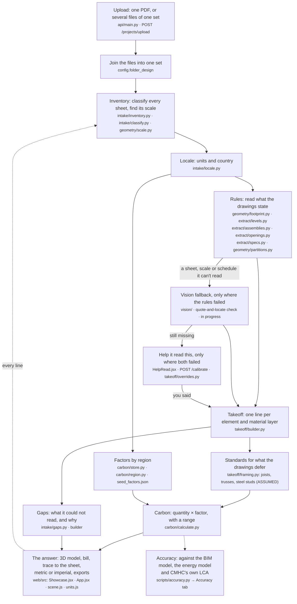

# How ecarbon works

A plan set goes in; a traceable bill of quantities and an A1–A3 embodied-carbon figure come out. Every number says whether it was **measured** off the linework, **inferred** from something a sheet states, or **assumed** from a stated standard, and every number traces back to the sheet it came from.

## The flow

## The labels, and why they matter

| Label | Means | Example |
|---|---|---|
| measured | taken off the linework, corroborated by a second source | the footprint, agreeing with the dimension strings |
| inferred | computed from something a sheet states | slab volume = measured footprint × the stated thickness |
| assumed | a stated standard stood in, and the line says which | I-joists at 302 mm, 400 mm centres, where the structure is deferred |
| "you said" | the user supplied it in *Help it read this* | a scale from two clicks and "23'-6\"" |
| "read by AI" | a vision model read it, and the quote was found on the sheet | a schedule on a scanned page |

What the tool cannot read, it says so on the bill rather than guessing. It also never sums across life-cycle modules: the figure is A1–A3 only.

## Where the code lives

| Area | Module |
|---|---|
| Sheet inventory and classification | `ecarbon/intake/` |
| Geometry: scale, footprint, partitions | `ecarbon/geometry/` |
| Text: levels, assemblies, openings, specs | `ecarbon/extract/` |
| Vision fallback | `ecarbon/vision/` |
| The bill | `ecarbon/takeoff/builder.py`, `framing.py`, `overrides.py` |
| Carbon and factors | `ecarbon/carbon/` |
| API | `ecarbon/api/main.py` |
| Interface | `web/src/` |
| Benchmarks | `ecarbon/bench/`, `scripts/accuracy.py`, `scripts/score_blind.py` |
